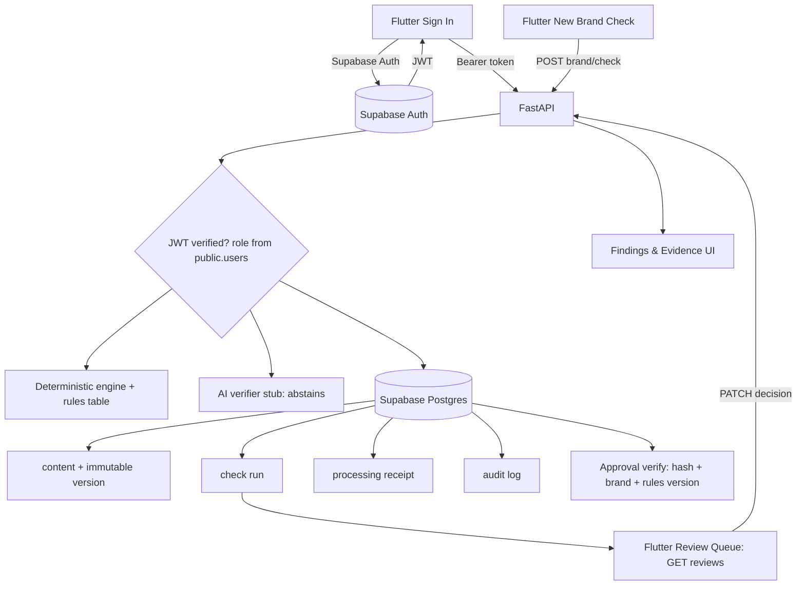

# BrandGuard

### Check content. Review evidence. Approve with confidence.

**A mobile-first brand governance and content review workspace built with Flutter, FastAPI and Supabase.**

BrandGuard creators aur reviewers ko ek shared workflow deta hai: content prepare karein, brand rules ke against check karein, evidence inspect karein aur exact content version par human approval record karein.

<<<<<<< HEAD
**[Open Live App](https://brandguard-app.antideploy.app)** · **[Quick User Guide](START_HERE.md)** · **[Deployment Guide](DEPLOYMENT.md)** · **[API Documentation](https://brandguard-app.antideploy.app/docs)**
=======
**[Mobile Login Fix / Rebuild Guide](LOGIN_FIX.md)** · **[Open Live App](https://brandguard-app.antideploy.app)** · **[Quick User Guide](START_HERE.md)** · **[Deployment Guide](DEPLOYMENT.md)** · **[API Documentation](https://brandguard-app.antideploy.app/docs)**
>>>>>>> 1127c4e (Complte task)

> **Current status:** Public hosting, Supabase integration, signup confirmation aur password recovery verified hain. Paid AI integration prepared hai, lekin wallet funding aur live quality verification tak **AI disabled** hai. Rule-based checks aur human review independently work karte hain.

---

## Contents

- [Features](#features)
- [Technology Stack](#technology-stack)
- [Architecture](#architecture)
- [Project Structure](#project-structure)
- [Quick Start](#quick-start)
- [Content Review Workflow](#content-review-workflow)
- [Configuration](#configuration)
- [API Overview](#api-overview)
- [Testing and Verification](#testing-and-verification)
- [Deployment](#deployment)
- [Security and Access](#security-and-access)
- [Known Limits](#known-limits)
- [Documentation](#documentation)
- [License](#license)

## Features

| Area | What BrandGuard provides |
|---|---|
| **Account access** | Email/password sign-in, signup confirmation, password recovery, current identity, session refresh aur logout. |
| **Role-based workflows** | Creator submissions aur trusted Reviewer/Admin permissions; public signup se role elevation nahi hoti. |
| **Brand library** | Shared guidelines, versioned enforceable rules aur reviewer-verified fact sources. |
| **Content checks** | Server-side deterministic checks, findings aur content evidence. AI unavailable ho toh explicit abstention. |
| **Human review** | Exact submitted version ko approve/reject karein; review notes aur decision history retain hoti hai. |
| **Approval verification** | Exact content aur rule-version changes ke against approval validity verify hoti hai. |
| **Saved drafts** | Server-backed drafts, attachment references, revisions aur stale-update conflict detection. |
| **Private documents** | TXT, Markdown aur text-based PDF upload, extraction, preview aur authorized download. |
| **Processing records** | Protected receipts, content hashes, version history aur audit events. |
| **Workspace activity** | Real dashboard totals, scoped analytics aur server-stored in-app notifications. |

**Important:** A clean automated scan is **not** human publication approval. AI assessment bhi factual truth ki guarantee nahi hai.

## Technology Stack

| Layer | Technology |
|---|---|
| Main application | Flutter / Dart — Android, iOS aur optional web source |
| Backend | FastAPI, Pydantic, Uvicorn |
| Persistence | SQLAlchemy with PostgreSQL; isolated local development ke liye SQLite |
| Hosted identity | Supabase Auth |
| Hosted files | Supabase private Storage |
| Auth email | Signed Supabase Send Email Hook → Antideploy transactional relay |
| Optional AI | OpenRouter-compatible server-side integration; currently disabled |
| Hosting | Antideploy, custom non-root Docker container |
| Tests | Pytest, Flutter unit/widget tests, separate live API/browser checks |

<<<<<<< HEAD
**Tested toolchain:** Python **3.13.18**, Flutter **3.50.0**, Dart **3.14.0**. Local launcher requires Python **3.11+**; mobile source requires Dart **`^3.14.0`**. App/API version: **2.0.0**.
=======
**Tested toolchain:** Python **3.13.18**, Flutter **3.50.0**, Dart **3.14.0**. Local launcher requires Python **3.11+**; mobile source requires Dart **`^3.14.0`**. Mobile version: **2.0.1+3**; unchanged backend API version: **2.0.0**.
>>>>>>> 1127c4e (Complte task)

## Architecture

```text
Flutter mobile app / bundled Flutter web app
                    |
              HTTPS /api/v1
                    |
              FastAPI backend
              |     |      |
              |     |      +--> Supabase private Storage
              |     +---------> PostgreSQL workflow data
              +---------------> Supabase Auth
                    |
                    +--> Optional grounded AI provider
                         (disabled until funded and verified)

Supabase Auth --> Signed email hook --> Antideploy email relay
```

- **`mobile/` main aur only Flutter project root hai.**
- `browser_preview/` isi app ka compiled web bundle hai; separate frontend codebase nahi.
- Hosted web UI aur API same HTTPS origin par serve hote hain.
- Native Flutter app backend se baat karta hai; private database/provider credentials app mein embed nahi hote.

## Project Structure

```text
BrandGuard-Antideploy/
├── mobile/                    # Main Flutter application
│   ├── lib/
│   │   ├── app/               # App setup and theme
│   │   ├── core/              # Sessions, API client and document picker
│   │   └── features/          # Auth, checks, reviews, drafts, library, etc.
│   ├── assets/                # Bundled fonts and licenses
│   ├── test/                  # Flutter unit/widget tests
│   ├── android/
│   └── ios/
├── backend/
│   ├── app/                   # API, authorization and domain services
│   │   ├── routers/
│   │   └── checks/            # Deterministic and optional AI checks
│   ├── certs/                 # Public Supabase CA and provenance
│   ├── supabase/              # Existing provisioning/migration scripts
│   ├── tests/
│   ├── tests_secure/
│   ├── .env.example           # Placeholders only; never real credentials
│   └── requirements.txt
├── browser_preview/           # Prebuilt web assets
├── docs/                      # Setup and technical documentation
├── validation/                # Recorded, sanitized verification evidence
├── Dockerfile                 # Production container
├── serve.py                   # Production entrypoint
├── start_backend.py           # Local setup/start launcher
├── OPEN_APP.bat               # Windows local browser launcher
├── START_HERE.md               # Short user guide
├── DEPLOYMENT.md               # Current hosted setup and operational limits
└── README.md
```

## Quick Start

### 1. Use the live app — no installation

Open **https://brandguard-app.antideploy.app** on your phone or desktop browser.

1. **Create account** se register karein.
2. Email confirmation link open karein.
3. Apne email/password se sign in karein.
4. Password bhool gaye hon toh **Forgot password?** use karein.

Public registration **Creator** account banati hai. Reviewer/Admin access trusted administrator assign karta hai. Hosting account ka Google sign-in aur BrandGuard app ka email/password sign-in alag hain.

> Free hosting idle hone par first request ko wake-up mein thoda waqt lag sakta hai. Live app use karne ke liye laptop par backend chalaye rakhna zaroori nahi.

### 2. Run native Flutter against the hosted API

Flutter SDK aur target emulator/device ready hone ke baad:

```sh
cd mobile
flutter clean
flutter pub get --enforce-lockfile
flutter run --dart-define=API_BASE=https://brandguard-app.antideploy.app
```

<<<<<<< HEAD
Is option mein apna local Python server start karna zaroori nahi. Actual native release signing/device certification is command se claim nahi hoti.
=======
**Is release mein native default live HTTPS hai:** `https://brandguard-app.antideploy.app`.
Windows par root ka **`RUN_MOBILE.bat`**, Mac/Linux par **`./RUN_MOBILE.sh`** bhi use
kar sakte hain. VS Code ke liye root mein hosted launch configuration included hai.
Purane IDE arguments mein `API_BASE=http://10.0.2.2:8000` ho toh remove karein;
explicit override always wins. Old installed app ko fully stop/rebuild karein,
sirf hot reload nahi. Details: [LOGIN_FIX.md](LOGIN_FIX.md).

Is option mein apna local Python server start karna zaroori nahi. Actual native
release signing/device certification is command se claim nahi hoti. ZIP source
release hai; APK/IPA included nahi hai.
>>>>>>> 1127c4e (Complte task)

### 3. Run an isolated local demo

**Use a separate development copy with no production `.env` or injected cloud variables.** Current configured workspace ka private cloud `.env` delete/overwrite mat karein. Without cloud configuration, backend local SQLite aur local demonstration accounts use karta hai.

From the project root:

```sh
python start_backend.py --web --host 127.0.0.1
```

Mac/Linux par zaroorat ho toh `python3` use karein. Windows par **`OPEN_APP.bat`** double-click bhi kar sakte hain.

Launcher `backend/.venv` create karta hai, pinned dependencies install karta hai aur server ready hone par browser open karta hai. First dependency installation ke liye internet aur Python 3.11+ chahiye. Terminal open rakhein; **Ctrl+C** se server stop hota hai.

| Local service | Address |
|---|---|
| Browser app | http://127.0.0.1:8000/ |
| Health check | http://127.0.0.1:8000/health |
| Interactive API docs | http://127.0.0.1:8000/docs |

**Local demonstration accounts — local mode only:**

| Role | Email | Password |
|---|---|---|
| Creator | `creator@brandguard.demo` | `Demo@12345` |
| Reviewer | `reviewer@brandguard.demo` | `Demo@12345` |

These deliberately public local credentials **do not work on the hosted Supabase app**. Seeded local demo mode ko internet par expose na karein. Local mode real confirmation/reset emails send karne ka pretend nahi karta.

To run just the local API:

```sh
python start_backend.py --host 127.0.0.1
```

<<<<<<< HEAD
Native Flutter development ke liye API address choose karein:
=======
Only local native development ke liye explicit `--dart-define=API_BASE=...` pass karein. Neeche wale addresses ab automatic defaults nahi hain:
>>>>>>> 1127c4e (Complte task)

| Target | Local API address |
|---|---|
| Android emulator | `http://10.0.2.2:8000` |
| iOS simulator / desktop | `http://127.0.0.1:8000` |
| Physical phone | Computer ka reachable LAN IP; server ko LAN interface par bind karein |
| Flutter web development | Explicit API URL, ya same-origin hosted setup |

Physical phone ka `localhost` computer nahi hota. LAN testing ke liye server ko `--host 0.0.0.0` se start karein aur firewall/network access check karein. Public deployment mein HTTPS aur cloud Auth use karein, local demo accounts nahi.

## Content Review Workflow

```text
Creator signs in
      ↓
Prepare exact editor text / reopen a saved draft
      ↓
Run brand checks → inspect findings and processing receipt
      ↓
Independent Reviewer inspects the submitted version
      ↓
Approve or reject with a note
      ↓
Verify approval against exact content and current rule version
```

1. Reviewer shared guidelines, enforceable rules aur verified fact sources maintain karta hai.
2. Creator content enter karta hai. Document upload karne par **sirf attachment add hona content scan nahi hai**; extracted text editor mein insert karein agar usse check karna hai.
3. Backend exact editor text check karta hai aur versioned record/receipt save karta hai.
4. Reviewer **Review Queue** mein exact submission inspect karke decision deta hai. Self-review blocked hai.
5. Content edit/recheck se new version banta hai. Relevant rule changes approval ko stale kar sakte hain; purana approval blindly reuse nahi hota.
6. Creator dashboard, notifications, history aur receipt se actual server-side outcome dekh sakta hai.

## Configuration

`backend/.env.example` placeholders aur available settings document karta hai. Kisi **new unconfigured development environment** mein isse private `backend/.env` banaya ja sakta hai. Existing production configuration ko replace na karein.

| Variable / group | Purpose |
|---|---|
| `AUTH_PROVIDER` | Explicit `local` or `supabase` Auth mode |
| `SEED_DEMO_USERS` | Local demo seeding; production mein `false` |
| `DATABASE_URL` | Private server-side SQL connection |
| `SUPABASE_URL`, `SUPABASE_PUBLISHABLE_KEY` | Selected Supabase project configuration |
| `SUPABASE_STORAGE_BUCKET` | Private document bucket |
| `AUTH_REDIRECT_URL`, `PUBLIC_APP_URL` | Controlled auth callbacks and app origin |
| `CORS_ORIGINS` | Explicit allowed frontend origins |
| `AI_PROVIDER`, `AI_BASE_URL`, `AI_MODEL` | Optional server-side model configuration |
| `OPENROUTER_API_KEY` | Platform-provisioned private AI key; never a Flutter define |
| `SUPABASE_EMAIL_HOOK_SECRET` | Signed Supabase email-hook verification |
| `RESEND_*`, `EMAIL_FROM` | Platform-provisioned transactional relay settings |

### Hosted Supabase and email

The existing BrandGuard project is already connected; another project/database create karna zaroori nahi. Current host uses PostgreSQL with **CA + hostname verification (`sslmode=verify-full`)**, Supabase Auth aur private Storage.

- Site URL uses the hosted app origin.
- Exact `/auth/confirm` aur `/auth/reset` callbacks configured hain.
- Signed `/api/v1/auth/hooks/email` endpoint auth email relay ko call karta hai.
- Normal runtime mein Supabase service/admin key required nahi hai.
- Native relay variables ko duplicate user variables se shadow mat karein.

Setup/maintenance details: [Supabase guide](docs/SUPABASE_SETUP.md) · [Current cloud status](docs/LIVE_SUPABASE_STATUS.md).

### Optional AI — honest availability

Hosted configuration mein paid AI abhi **disabled** hai. Ek application-specific OpenRouter key already provisioned hai, lekin wallet funding aur real inference/quality tests pending hain. Duplicate key create karne ki zaroorat nahi.

After authorized funding and activation, configured path uses `openai/gpt-5.4-mini` with strict structured output and independent server-side citation/quote/span validation. Provider availability, source quality aur human judgment phir bhi necessary hain.

**Missing access, missing evidence, provider failure ya invalid output → `abstained`, not a fabricated factual pass.**

Activation, cost/privacy boundaries aur live test checklist: [AI setup](docs/AI_SETUP.md).

## API Overview

Hosted base URL: **`https://brandguard-app.antideploy.app`**. Most application endpoints require a valid bearer token; role and ownership checks server-side enforce hote hain.

| Method | Route | Purpose |
|---|---|---|
| `GET` | `/health` | Public service health |
| `POST` | `/api/v1/auth/signup`, `/api/v1/auth/login` | Registration and password sign-in |
| `GET` | `/api/v1/auth/me` | Current authenticated identity |
| `POST` | `/api/v1/auth/refresh`, `/api/v1/auth/logout` | Session lifecycle |
| `POST` / `PUT` | `/api/v1/auth/recover` / `/api/v1/auth/password` | Recovery request / password update |
| `POST` | `/api/v1/brand/check` | Run a content check |
| `POST` | `/api/v1/brand/{check_id}/versions` | Submit a new checked version |
| `GET` / `PATCH` | `/api/v1/reviews` / `/api/v1/reviews/{check_id}/decision` | Review queue / human decision |
| `POST` | `/api/v1/approvals/verify` | Verify exact-content approval |
| `GET`, `POST`, `PUT`, `DELETE` | `/api/v1/library/{kind}` and item routes | Guidelines, rules and fact sources |
| `POST` / `GET` | `/api/v1/files` / `/api/v1/files/{asset_id}/download` | Private upload / authorized download |
| `GET`, `POST`, `PUT`, `DELETE` | `/api/v1/drafts` and item routes | Saved drafts |
| `GET` | `/api/v1/receipts/{receipt_id}` | Protected processing receipt |
| `GET` | `/api/v1/analytics`, `/api/v1/history`, `/api/v1/audit` | Scoped workspace records |
| `GET` | `/api/v1/notifications`, `/api/v1/system/status` | Activity and authenticated runtime status |

Full request/response schemas: **[Interactive API docs](https://brandguard-app.antideploy.app/docs)**.

Simple health check:

```sh
curl https://brandguard-app.antideploy.app/health
```

## Testing and Verification

### Run backend tests

With your backend virtual environment activated:

```sh
cd backend
python -m pip install -r requirements-dev.txt
python -m pytest -q tests tests_secure
```

Fixtures temporary local stores use karte hain aur real cloud settings se isolate hote hain. Ad-hoc seeded smoke tests ko production database ke against run na karein.

### Run Flutter checks

```sh
cd mobile
flutter pub get --enforce-lockfile
flutter analyze
<<<<<<< HEAD
flutter test
```

### Latest completed deployment verification

=======
flutter test --concurrency=1
```

### Current mobile login-fix release

| Check | Result |
|---|---|
| Backend regression suite rerun | **113 passed** |
| Flutter unit/widget regression suite | **75 passed**, including 26 new connection/UI checks |
| Flutter analyzer | **No issues found** |
| Native Dart → live HTTPS | **13 passed**: both trusted roles, identity/dashboard, logout/token denial, safe signup reachability |
| Updated browser bundle | Release build successful; both rendered role logins and actual cloud dashboards verified through a test-only API bridge |

Current evidence: [`validation/login-fix/`](validation/login-fix/).
Native HTTPS verification used the Dart VM and this source's endpoint resolver, not
an Android emulator/device build. Invalid-role signup was rejected with 422 without
creating users or sending extra emails. Existing cloud database/accounts/roles and
production deployment were not replaced. Physical-device/APK testing is not claimed.

### Previous completed deployment verification

>>>>>>> 1127c4e (Complte task)
| Check | Recorded result |
|---|---|
| Backend regression/security/provider contracts | **113 passed** |
| Flutter unit/widget tests | **49 passed** |
| Flutter analyzer | **No issues found** |
| Public API → real Supabase workflows | **55 passed** |
| Signup/email/callback/password-recovery checks | **17 passed** |
| Actual mobile-sized Chromium login | **Creator + Reviewer verified** at 430×932 |
| Test email delivery reports | **5/5 provider-reported delivered** |
| Antideploy automatic and full security scans | **0 findings** after the header/CSP correction |

Detailed evidence: [Validation report](validation/RESULTS.md) and [`validation/antideploy/`](validation/antideploy/).

<<<<<<< HEAD
Counts recorded deployment checks ko refer karte hain; documentation edit ek new runtime test run nahi hai. Some unit/provider tests mocked hain; separate live API/browser checks ko unse mix nahi kiya gaya. Delivery reports human mailbox opening prove nahi karte, aur platform scans independent penetration-test certification nahi hain.
=======
Is second table ke counts earlier deployed release ke historical checks hain; email/security/workflow suites ko is mobile fix ke liye dobara run nahi kiya gaya. Some unit/provider tests mocked hain; separate live API/browser checks ko unse mix nahi kiya gaya. Delivery reports human mailbox opening prove nahi karte, aur platform scans independent penetration-test certification nahi hain.
>>>>>>> 1127c4e (Complte task)

## Deployment

Current deployment **Antideploy** par hai. Updates ke liye existing application reuse karein; project identity `.antideploy.json` mein stored hai.

```text
Dockerfile
   → non-root Python 3.13 container
   → serve.py
   → backend working directory
   → app.web:app
   → 0.0.0.0:$PORT, one worker
```

- `PORT` platform supply karta hai; fallback `8080` hai.
- Entrypoint production mein local/demo Auth refuse karta hai.
- Existing users/database/files ko replace ya reseed nahi karta.
- Backend working directory bundled public TLS CA path resolve karti hai; certificate verification disable na karein.
- Secrets encrypted host variables/private files mein rehte hain, source upload mein nahi.
- Runtime/env changes ke baad appropriate upload/redeploy required hai; README-only edits ke liye unnecessary redeploy nahi.

<<<<<<< HEAD
`browser_preview/` prebuilt artifact hai. Dart source change hone par web bundle rebuild/update karna hoga; Antideploy upload limits aur required CanvasKit assets verify karke deploy karein.
=======
`browser_preview/` prebuilt artifact hai. Dart source change hone par web bundle rebuild/update karna hoga:

```sh
cd mobile
flutter build web --release --no-wasm-dry-run --no-web-resources-cdn
```

Fresh `mobile/build/web/` ko `browser_preview/` mein copy karein. Included custom
bootstrap service worker register nahi karta, taaki stale login configuration cache
na ho. Hosting upload ke liye unused skwasm/wimp/webparagraph, `.symbols` aur `.map`
files prune kar sakte hain; **generic aur Chromium CanvasKit JS/WASM dono retain**
karein. Antideploy upload limits verify karke hi redeploy karein.
>>>>>>> 1127c4e (Complte task)

**Deployment instructions:** [DEPLOYMENT.md](DEPLOYMENT.md) · [Antideploy agent guide](https://antideploy.com/agent.md).

## Security and Access

- **Private credentials:** `.env`, database passwords, signing secrets, admin keys aur AI/relay credentials Git, Flutter, screenshots ya public ZIP mein commit na karein.
- **Trusted roles:** client-editable user metadata se Reviewer/Admin privilege grant nahi hota.
- **Private files:** owner/trusted-reviewer access enforce hota hai; documents public bucket mein serve nahi hote.
- **Session handling:** app tokens memory mein rakhta hai, ordinary preferences mein nahi; app restart par sign-in required ho sakta hai.
- **Auth callbacks:** token fragments clear hote hain; reset/confirmation tokens browser local/session storage mein persist nahi hote.
- **Defense in depth:** signed email hooks, protected API responses aur security headers/CSP configured hain.
- **Review integrity:** automated scan result, AI result aur human approval separate concepts hain.

Previously issued private evaluation accounts time-limited hain: app/private Storage access **17 November 2026, 01:30:31 IST** (`2026-11-16T20:00:31Z`) par expire hota hai. Credentials is README mein include nahi kiye gaye. Normal accounts without the trusted demo-expiry flag is expiry se affected nahi hote.

## Known Limits

- Paid AI access/quality is **not yet live-verified**; rule-based checks and human review available hain.
- Documents: TXT/Markdown/text-based PDF only; **5 MB**, **30 PDF pages**, up to **100,000 extracted characters**. AI input limit **12,000 characters** hai.
- OCR, URL crawling, embeddings/vector retrieval aur malware scanning implemented nahi hain. Retrieval lexical passage matching use karta hai.
- In-app notifications refresh/poll based hain; push delivery aur general product-email notifications implemented nahi hain.
- Workspace single-workspace design hai; high-throughput normalized multitenancy ya background retention worker claim nahi kiya gaya.
- Separate “Request Changes” state nahi hai; rejection plus reviewer note use hota hai.
- Email-address-change double confirmation implemented app feature nahi hai. Current native auth-email allowance **20 recipients/day** hai, subject to the hosting plan.
- Native APK/IPA signing/device certification, full UI E2E coverage, production load testing aur cloud backup/restore recovery drill complete claim nahi kiye gaye.
- [LICENSE](LICENSE) abhi placeholder hai; public redistribution se pehle actual project license finalize karna hoga.

## Documentation

| Document | Use it for |
|---|---|
| [START_HERE.md](START_HERE.md) | App kholna, sign-in aur basic workflow |
| [DEPLOYMENT.md](DEPLOYMENT.md) | Current hosting, email, access, AI and operational handoff |
| [Supabase setup](docs/SUPABASE_SETUP.md) | Existing DB/Auth/private Storage maintain karna |
| [Live Supabase status](docs/LIVE_SUPABASE_STATUS.md) | Connected project and current verified state |
| [AI setup](docs/AI_SETUP.md) | Funding/activation prerequisites, grounding and limitations |
| [Project guide](docs/PROJECT_GUIDE.md) | Technical reference and administration |
<<<<<<< HEAD
=======
| [Mobile login fix](LOGIN_FIX.md) | Hosted default, rebuild steps, safe local overrides and limits |
>>>>>>> 1127c4e (Complte task)
| [Validation results](validation/RESULTS.md) | Actual checks, evidence and untested areas |

Earlier ready-demo ZIP aur previous source releases preserved hain. Local/demo distribution aur current hosted deployment ke private environments interchangeable nahi hain.

## License

Project license **not finalized yet**. [`LICENSE`](LICENSE) currently selection placeholder hai; MIT/Apache ya koi aur license assume na karein. Bundled font licensing `mobile/assets/fonts/OFL.txt` mein available hai.

---

<<<<<<< HEAD
## Current flow



=======
>>>>>>> 1127c4e (Complte task)
**BrandGuard — clear checks, traceable evidence, accountable human decisions.**
