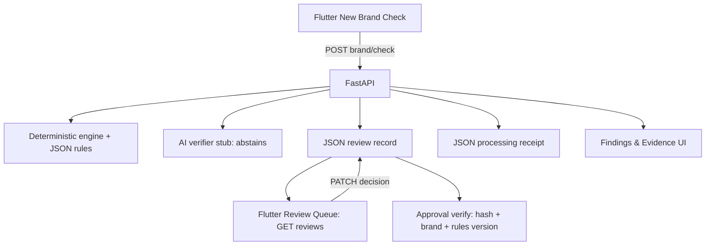

# BrandGuard

BrandGuard is a pre-publication brand-governance prototype. It checks draft marketing copy against deterministic and brand-specific rules, displays matched evidence, records review decisions, and verifies approvals against a content hash.

> **Current status (15 Nov 2026):** A working vertical slice has a FastAPI backend and a Flutter Web client connected for checks and review-queue operations. It is still a prototype—not production-ready. Some UI actions remain demo/local state. Read [Implementation Status](docs/IMPLEMENTATION_STATUS.md) and [AI Handoff](docs/AI_HANDOFF.md) first.

## Implemented today

- FastAPI app, root and health routes, local-development CORS.
- `POST /api/v1/brand/check`: deterministic checks, creates a check/review record and processing receipt.
- Generic rules for unfinished placeholders and selected absolute claims.
- Versioned JSON rules for the fictional Acme brand.
- `GET /api/v1/brand/rules/{brand_name}`.
- JSON-backed review/check records and receipt storage.
- `GET /api/v1/reviews`, `PATCH /api/v1/reviews/{check_id}/decision`.
- `POST /api/v1/approvals/verify`: verifies approved state, brand, content hash, and current rule version.
- `GET /api/v1/receipts/` and `GET /api/v1/receipts/{receipt_id}`.
- Flutter New Brand Check sends text to the API; Findings & Evidence renders returned findings.
- Flutter Review Queue fetches backend records and calls backend decision endpoints.

## Important limitations

- AI verification is a stub that abstains when verified brand facts are unavailable; no LLM provider or fact retrieval is connected.
- Persistence is JSON files, not PostgreSQL; unsuitable for production concurrent traffic.
- Authentication, role-based authorization, hardened audit controls, guideline ingestion, five-gate verification, and deployment are not implemented.
- Findings & Evidence still has demo context/suggestion state and a local submission helper; receipt details are not fully surfaced in the client.
- Request Changes is represented as a rejected decision with a reason note.
- The PRD describes a broader planned product than this working code slice.

## Quick start (Windows PowerShell)

Prerequisites: Python 3.10+, Flutter SDK, Chrome.

**Terminal A — backend (from repository root):**

```powershell
cd backend
python -m pip install fastapi uvicorn
python -m uvicorn app.main:app --reload
```

API: `http://127.0.0.1:8000` · Swagger: `http://127.0.0.1:8000/docs` · Health: `http://127.0.0.1:8000/health`

**Terminal B — Flutter Web (from repository root):**

```powershell
cd mobile/brandguard
flutter pub get
flutter run -d chrome
```

Flutter Web currently uses `http://127.0.0.1:8000`. An Android emulator typically needs `10.0.2.2`; a physical phone needs the host computer's LAN IP.

## Current flow



## Documentation map

- [Implementation Status](docs/IMPLEMENTATION_STATUS.md) — implemented, partial, planned, next.
- [AI Handoff Guide](docs/AI_HANDOFF.md) — context for a teammate or coding AI cloning the repo.
- [Architecture](docs/architecture.md) · [Application Flow](docs/app-flow.md) · [Implementation Plan](docs/implementation-plan.md) · [Feature Tickets](docs/feature-tickets.md).
- [PRD](docs/prd.md) and [TRD](docs/trd.md) — broader requirements baseline, not a feature-completion claim.

Acme and TaskFlow examples are fictional. Treat all sample rules as demo-only.
