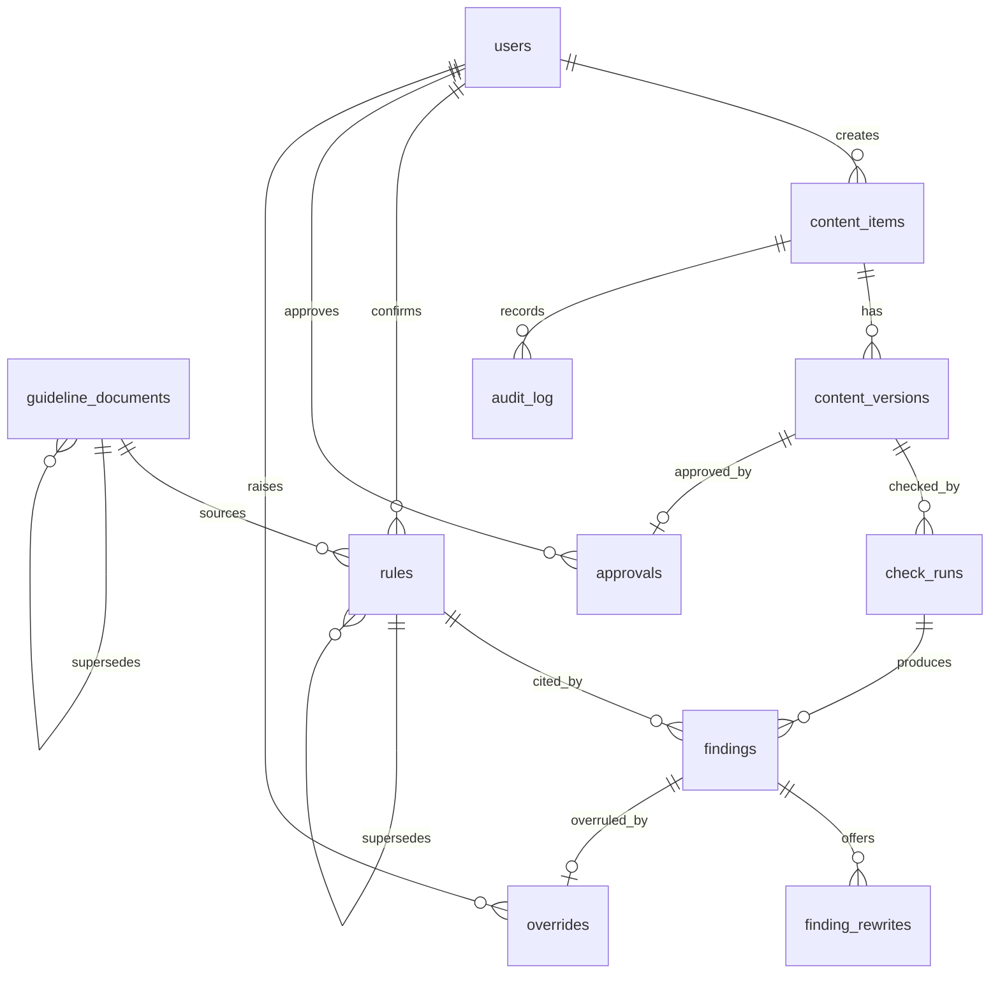

# 03 · Data model

Eleven tables, ten enums, four triggers. Target: PostgreSQL 16.
Files: [`001_schema.sql`](../database/001_schema.sql) (structure, constraints),
[`002_functions.sql`](../database/002_functions.sql) (behaviour),
[`003_seed.sql`](../database/003_seed.sql) (the demo world).

## ERD



## Tables

| Table | Rows are | Key fact |
|---|---|---|
| `users` | people who may act, with a role and an `is_active` flag | a deactivated account cannot approve, enforced by a trigger |
| `guideline_documents` | source documents, versioned, with a SHA-256 | a rule without a source page is an opinion |
| `rules` | rule versions, PK `(rule_id, version)` | never edited in place; a correction supersedes |
| `content_items` | the thing being published | one row per post/email/hero |
| `content_versions` | immutable snapshots of the text + its hash | the unit of approval |
| `check_runs` | one judgement of one version, with a timestamp | findings are only valid against the rules live at that moment |
| `findings` | one claim about one span, citing one rule version | five statuses, only two of which block |
| `finding_rewrites` | three repairs per finding (A/B/C) | exactly one may be accepted, by partial unique index |
| `approvals` | one row per content version, with the hash | voided by a trigger when a newer version appears |
| `overrides` | a person's reasoned disagreement with a finding | unique per finding; becomes a clarity ticket |
| `audit_log` | append-only history | `UPDATE` and `DELETE` raise |

## Enums

`user_role` (admin, creator, reviewer) · `rule_type` (fact, term, tone, claim, visual) ·
`rule_status` (DRAFT, ACTIVE, SUPERSEDED, EXPIRED) · `risk_tier` (standard, high) ·
`finding_status` (the five) · `system_action` (BLOCK_EXPORT, ADVISORY, FLAG_REVIEW,
ESCALATE_ADMIN, ROUTE_LEGAL) · `approval_state` (DRAFT, CHECKS_RUN, IN_REVIEW, APPROVED,
VOID) · `check_outcome` (RUNNING, COMPLETED, ABSTAINED, FAILED) · `audit_actor_type`
(USER, SYSTEM) · `audit_action` (submitted, checked, edited, overridden, approved, voided)
· `document_status` (DRAFT, ACTIVE, SUPERSEDED, EXPIRED).

Enums rather than text because a typo in a status should require a migration, not silently
remove a row from every filtered view.

## The nine invariants

Each of these is a `CHECK`, a trigger, or a unique index — never a convention.

1. **`status = 'ACTIVE'` requires a confirming human.**
   `CHECK (status <> 'ACTIVE' OR confirmed_by IS NOT NULL)`. An unconfirmed rule cannot be
   cited, so the seed's `LEGL-001` sits in `DRAFT` with a null `confirmed_by` and is never
   live.
2. **A price-sensitive rule must expire.**
   `CHECK (NOT price_sensitive OR expires_on IS NOT NULL)`. A price with no end date is a
   price that can never be re-checked.
3. **Supersession pointers are all-or-nothing.**
   `(supersedes_rule_id IS NULL) = (supersedes_version IS NULL)`, and a rule cannot
   supersede itself.
4. **The content hash is computed, never supplied.**
   `content_version_set_hash()` (BEFORE INSERT) either fills a null hash or raises when a
   supplied hash disagrees with `content_hash(text, channel, fingerprints)`.
   `content_hash` = SHA-256 over a canonical form (NFKC, whitespace collapsed) with the
   channel and sorted asset fingerprints, so re-typing the same copy yields the same hash.
5. **A finding cannot cite a rule that was not live when the check ran.**
   `finding_requires_live_rule()` looks up `live_rules_at(check_runs.started_at)` and
   raises for `CONFIRMED_RULE_MATCH`. Use `SOURCE_CONFLICT_OR_EXPIRED` instead — that is
   what the status is for.
6. **A new version voids the standing approval.**
   `void_prior_approvals()` (AFTER INSERT) sets `state = 'VOID'`, stores
   `previous_hash` and `new_version_number` in `void_diff`, and writes an `audit_log` row
   as `SYSTEM`.
7. **Only an active, non-author reviewer can approve, with the right hash.**
   `approvals_require_authorised_reviewer()` checks role, `is_active`, author ≠ approver,
   and `content_hash = content_versions.canonical_hash`.
8. **One accepted repair per finding.** Partial unique index
   `finding_rewrites_one_accepted ... WHERE accepted`.
9. **The audit log is append-only.** `audit_log_no_update` raises on `UPDATE` or `DELETE`.

## Time: the part most systems get wrong

`live_rules_at(at)` is the only correct way to ask what was in force:

```sql
WHERE status <> 'DRAFT'
  AND effective_from <= at::date
  AND (expires_on IS NULL OR at::date <= expires_on)
  AND NOT EXISTS (SELECT 1 FROM rules successor
                   WHERE successor.supersedes_rule_id = r.rule_id
                     AND successor.supersedes_version = r.version
                     AND successor.status <> 'DRAFT'
                     AND successor.effective_from <= at::date)
```

Three things this gets right that `WHERE status = 'ACTIVE'` does not:

- A rule whose `expires_on` passed is not live, even if nobody has tidied its status
  column (`PROMO-001` in the seed is exactly that drifted row).
- A rule replaced by a successor in force is not live, even inside its own window
  (`PRIC-001` runs to +90 days, but `PRIC-002` took over 30 days ago).
- Asked about the past, it answers about the past. `PRIC-001` **was** live 100 days ago,
  so a finding from 100 days ago is still judged against it. Filtering on today's status
  column would silently rewrite history.

## Views

| View | Purpose |
|---|---|
| `v_live_rules` | `live_rules_at(now())` |
| `v_clarity_tickets` | overrides grouped by rule version — "this rule keeps being overruled" |

`refresh_rule_lifecycle()` tidies the `status` column for humans (`expires_on < today` →
`EXPIRED`; superseded-by-live-successor → `SUPERSEDED`). It is **not** what the checker
uses: `live_rules_at()` does not need the column to be tidy.

## What is not modelled

No `tenant_id`, no row-level security, no soft deletes, no file storage, no embeddings.
Retrieval is a channel + type filter (`live_rules_for_channel`), which is why `pgvector` is
not installed at all rather than installed and unused.

## Running it

```bash
make db        # 001 → 002 → 003, in that order
make db-test   # 28 assertions, inside a transaction, rolled back
```

The seed is relative to `CURRENT_DATE`. A demo that only works in the month it was written
is not a demo, and fixed dates are the usual reason a fresh clone shows "no live rules".
