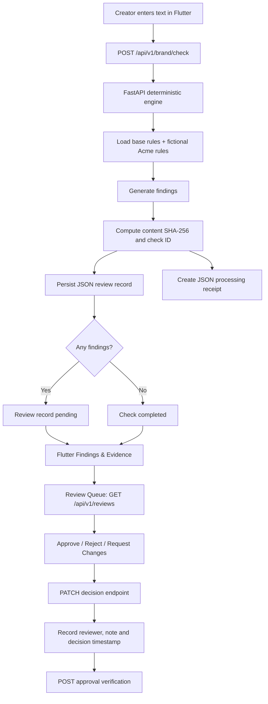

# Application Flow

This document distinguishes the flow implemented in the current prototype from the intended full product flow.

## Current implemented flow

## Status behavior

- Backend review record is `pending` when findings exist; otherwise `completed`.
- Brand check response is `review_required` when findings exist; otherwise `completed`.
- Backend decision values are `approved` and `rejected`.
- Flutter Request Changes is translated to rejected with a note; there is no distinct changes-requested backend state.
- A completed check with no findings is not a pending review.

## Current findings

Findings are deterministic regex matches only. The UI displays rule ID, severity, explanatory message, matched phrase, and attribution to the deterministic engine. No AI-produced finding is currently emitted. AI verification abstains when no verified facts are supplied.

## Target product flow (planned)

Admin source ingestion and confirmation → temporal/versioned rules → creator submission with channel/date/assets → deterministic and scoped AI checks → five verifier gates → evidence-backed findings or abstention → creator edit/dispute → reviewer approves exact canonical version → audit trail and void-on-edit.

Source ingestion, temporal rule filtering, verifier gates, immutable version history, identity enforcement, and append-only audit logging remain future work.

## Processing receipts

A receipt is created for each brand check and is retrievable from the receipt API. Flutter receives the receipt ID; receipt presentation in the client is not yet complete.
