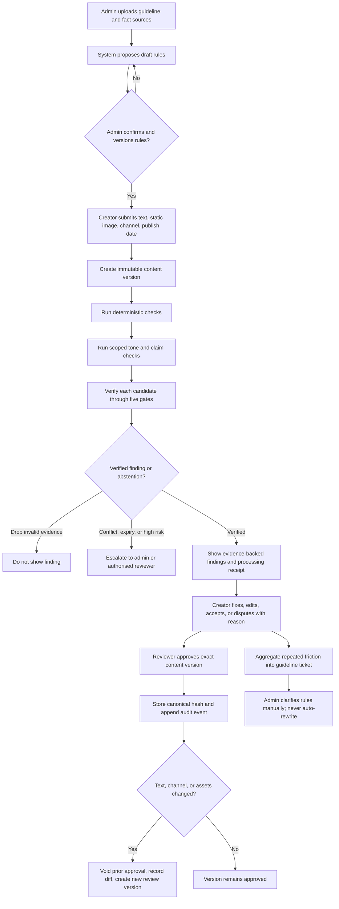

# Application Flow

This flow is the intended MVP workflow from the Round 1 submission.

## Roles

- **Admin:** ingests sources, confirms/version rules, and resolves source
  conflicts or expiry.
- **Creator:** submits a draft, reviews findings, edits or disputes with a
  reason.
- **Reviewer:** reviews evidence and approves a version; cannot be that
  version's creator.

## End-to-end flow

## Content state lifecycle

`DRAFT -> CHECKS_RUN -> IN_REVIEW -> APPROVED -> VOID`

An edit after approval does not preserve approval. The approved version is
voided, the diff is logged, and the changed version returns to review. A new
version is not implicitly approved.

## Finding outcomes

| Condition | System action | User-visible result |
| --- | --- | --- |
| Unknown rule ID | Drop at gate 1 | No finding displayed. |
| Evidence is a paraphrase or not in rule text | Drop at gate 2 | No finding displayed. |
| Rule expired or superseded | Escalate at gate 3 | Admin review required. |
| Two applicable sources conflict | Abstain at gate 4 | Source conflict; admin resolves. |
| No approved evidence | Do not adjudicate truth | Unsupported; needs verification. |
| High-risk/legal claim | Route by risk tier | Authorised reviewer required. |
| Finding passes every gate | Emit finding | Show rule version, quote, span, and action. |

## Processing receipt

Display a receipt for every model run. It identifies the submitted text, active
rule versions sent, redactions, and retention terms. The TaskFlow demo's
zero-training API terms are demo-specific; production terms must match the
selected provider and contract.
