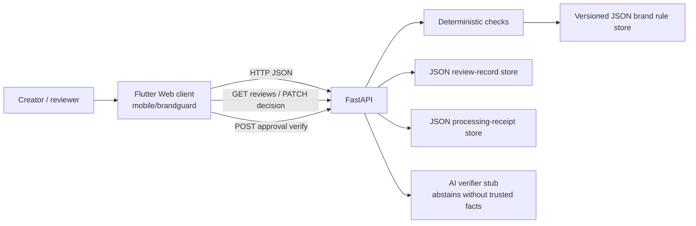

# Technical Architecture

**Status:** This document now describes the implemented prototype and distinguishes it from the broader target design.

## Implemented prototype architecture

| Component | Current behavior |
|---|---|
| `mobile/brandguard/` | Active Flutter Web client for recent API integration; some demo UI behavior remains. |
| `backend/app/main.py` | FastAPI app, router registration, local CORS, root and health. |
| `backend/app/checks/deterministic/` | Regex checks for placeholders and selected absolute claims. |
| `backend/app/rules_store/` | JSON rules with current/available versions; sample Acme rules. |
| `backend/app/approval/` | JSON check/review records, content SHA-256, decisions, approval verification. |
| `backend/app/receipts/` | JSON processing receipts created on each brand check. |
| `backend/app/checks/llm/` | Abstention interface; no provider configured. |
| `backend/app/routers/` | Brand, review/approval, and receipt APIs. |
| `packages/contracts/` | JSON Schema design contracts; not generated into runtime models. |

A separate Flutter project exists in `frontend/`; the current integration path is `mobile/brandguard/`.

## Current request path

Flutter posts text to `/api/v1/brand/check`; FastAPI runs base and brand-specific deterministic rules, generates a check ID and text hash, persists a review record and receipt, then returns findings. Flutter renders those findings and loads reviews from `/api/v1/reviews`. Decisions use the review PATCH endpoint. Approval verification checks status, brand, text hash, and current rule version.

## Target architecture (not implemented)

The broader proposal includes PostgreSQL/pgvector, scoped LLM checks, admin-confirmed temporal rules, five-gate source verification, immutable content versions, append-only audit records, and approvals bound to canonical text/channel/assets. These are goals—not current capabilities. See PRD/TRD and Implementation Status.

## Limitations

- Runtime persistence is JSON files, not PostgreSQL; it is not robust for concurrent production traffic.
- CORS allows all origins for local development; do not deploy unchanged.
- Authentication/authorization is not implemented.
- Approval hash covers submitted text only, not canonicalized channel/asset metadata.
- AI verifier is a safe abstention stub, not a connected model.
