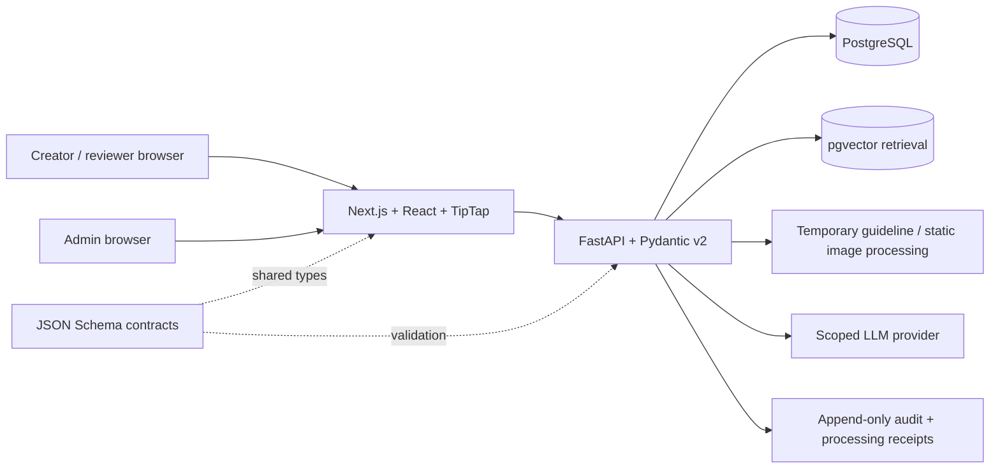
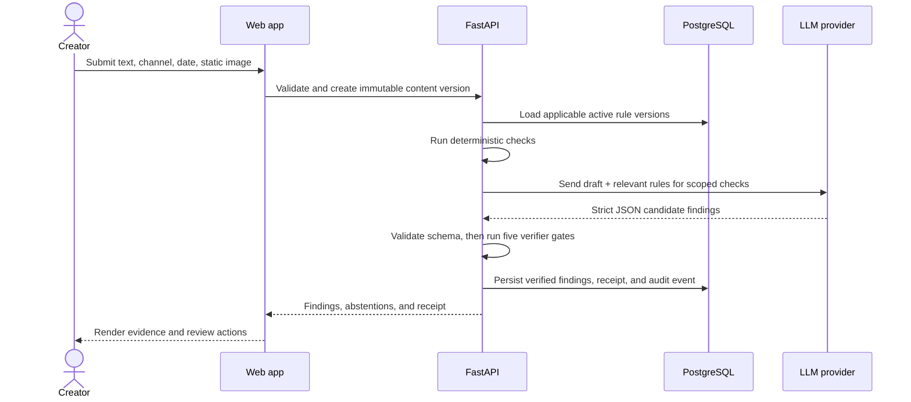

# Technical Architecture

**Status:** Proposed architecture from the Round 1 technical plan. The current
repository is a scaffold; these components are not yet running.

## System context

The browser is an untrusted client. The API is the authority for access checks,
rule activation, verifier gates, approval/void transitions, and audit writes.
PostgreSQL stores versioned relational records. pgvector may support semantic
retrieval, but a vector match never replaces rule status, source evidence, or
temporal validation.

## Request and decision path

AI output is untrusted until schema validation and all verifier gates pass.
Model failures, invalid JSON, expired rules, or conflicts must not produce a
success-shaped result.

## Component responsibilities

| Component | Responsibility |
| --- | --- |
| `frontend/` | Submission, rule administration, review studio, evidence highlights, receipt, and audit views. |
| `backend/app/ingest/` | Parse supported guideline inputs and propose draft rules. |
| `backend/app/rules_store/` | Versioned rules and temporal/channel applicability. |
| `backend/app/checks/` | Deterministic checks first; scoped strict-JSON LLM checks second. |
| `backend/app/verifier/` | Five-gate source verification, conflict handling, abstention, and escalation. |
| `backend/app/approval/` | Canonical content representation, SHA-256, approval, and void-on-edit. |
| `backend/app/audit/` | Append-only actor/action/reason history. |
| `backend/app/receipts/` | Record sent text, rule versions, redaction, and retention terms per model run. |
| `packages/contracts/` | Shared JSON Schema source for API and web types. |
| `databases/` | PostgreSQL schema, local service configuration, and fictional fixtures. |

## Persistence and transaction boundaries

- Read applicable rule versions and their status/date/channel within a
  transaction or consistent snapshot for each check.
- Persist a completed run, its receipt, verified findings, and audit event
  atomically.
- On edit after approval, create a new content version, mark the old approval
  `VOID`, store the diff, and append an audit event in one transaction.
- Keep uploaded artwork out of durable storage after checking. Store only
  derived fingerprints needed by the approved version.
- The database DDL is in [`../databases/schema.sql`](../databases/schema.sql); the model
  relationships are described in [`backend-schema.md`](./backend-schema.md).

## Deployment and unresolved decisions

The submission proposes PostgreSQL + pgvector, an API, and a web app composed
with Docker Compose. The current `databases/docker-compose.yml` remains a
placeholder. Authentication provider, public hosting, object-storage policy,
model provider, embedding dimension, network boundaries, and operational
monitoring still require explicit decisions before a pilot.
