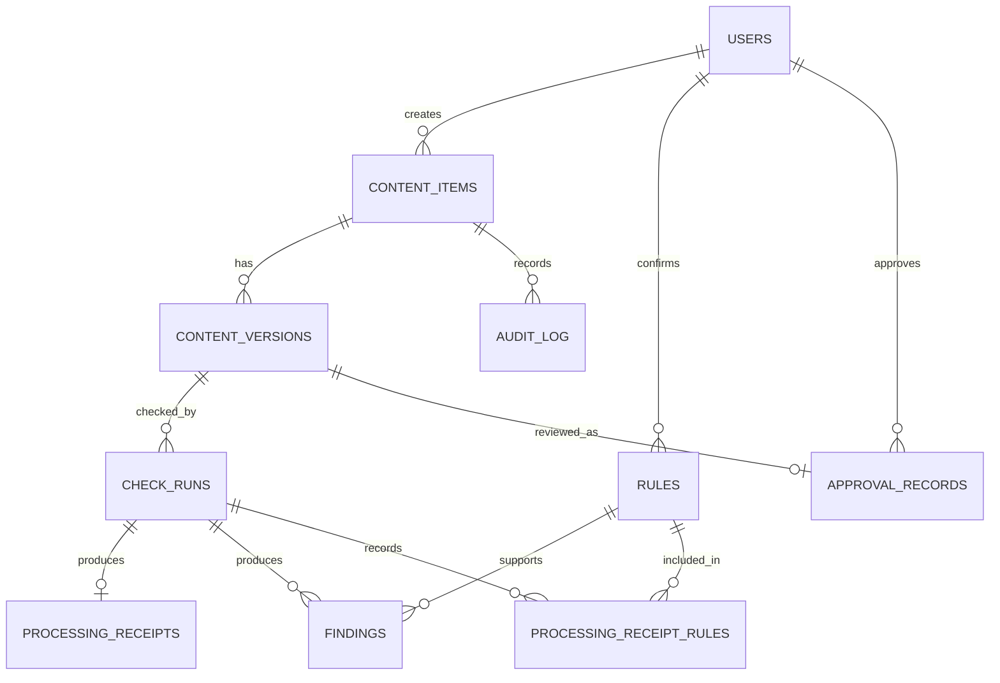

# Backend Schema

The PostgreSQL DDL is in [`../databases/schema.sql`](../databases/schema.sql). This
document explains its intended model; it does not mean a database has been
provisioned or migrations have been applied.

## Entity relationships



## Tables

| Table | Responsibility |
| --- | --- |
| `users` | Application identities and the admin/creator/reviewer role. Authentication credentials are intentionally outside this schema. |
| `content_items` | Submission owner, channel, and publish date. |
| `content_versions` | Immutable draft text, asset fingerprints, version number, and canonical SHA-256 hash. No artwork blob is stored. |
| `rules` | Composite rule ID/version, source, type, lifecycle dates/status, channels, risk tier, confirmation, and supersession link. |
| `check_runs` | Each check against one content version and its outcome. |
| `findings` | Verified candidate findings, status, exact quote, optional half-open character span, and system action. |
| `processing_receipts` | Text sent to a run, redaction record, provider, retention terms, and timestamp. |
| `processing_receipt_rules` | Exact rule versions sent with that run. |
| `approval_records` | One lifecycle record per content version, including hash, reviewer, approval time, and void diff. |
| `audit_log` | Append-only submit/check/edit/override/approve/void events. |

## Integrity and transaction rules

- A finding must reference an existing versioned rule and contain a non-empty
  evidence quote. Application verification must additionally ensure that the
  rule was active and applicable at the run time and that the quote is grounded.
- Canonicalization is application-owned: stable key ordering, whitespace and
  Unicode normalization, and sorted asset fingerprints before SHA-256.
- An approval hash must equal the content version hash. Only an active reviewer
  other than the creator may approve.
- Approval, void, audit-event, and content-version changes should be committed
  in one transaction. Edits create new versions; do not update a prior version.
- The database prevents update/delete/truncate of immutable content versions
  and the audit log. The production app role must not own these tables.
- Rule validity, channel applicability, conflict detection, and the five
  verifier gates require application logic; ordinary foreign keys cannot prove
  these temporal/evidence invariants.

## Setup and migration status

The schema targets a fresh PostgreSQL database with `pgvector` available. Apply
it with:

```sh
createdb brandguard
psql -d brandguard -v ON_ERROR_STOP=1 -f databases/schema.sql
```

No PostgreSQL server, migration runner, or executable application is configured
in the current scaffold. Once Alembic is introduced, move schema evolution into
reviewed migrations; do not treat this initial DDL as a migration strategy.
