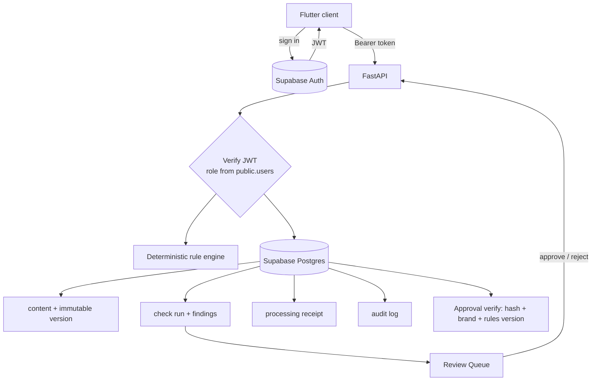

# 🛡️ BrandGuard — Brand Governance App

**No finding without evidence. No approval without a version.**

Ek mobile-first app jisme creator content likhta hai, backend usse brand rules se check karta hai,
aur authorised reviewer exact version ko sign-off karta hai — har decision ka proof + hash ke saath.

| | |
|---|---|
| 🌐 **Live app (web)** | https://brandguard-app.antideploy.app |
| 📱 **Mobile app** | Flutter (Android + iOS source included) |
| 🔗 **Repository** | https://github.com/smeet-jari18/smeet-jari18-Brand_Guard-App |
| 🏷️ **Version** | v2.1.0 (redesigned UI — *Executive Precision*) |

---

## 🔑 Demo Accounts (turant login karne ke liye)

Dono accounts **live hosted app** par working hain, email verified hain — koi signup/confirmation
nahi chahiye.

| Role | Email | Password | Kya kar sakta hai |
|---|---|---|---|
| 👤 **Creator** | `raj@gmail.com` | `Admin@1234` | Naya brand check banaye, draft save kare, apne checks + receipts dekhe, reviewer ko submit kare |
| 🛡️ **Reviewer** | `admin@gmail.com` | `Admin@1234` | Sab submissions dekhe, approve / reject kare, rules aur guidelines manage kare, audit ledger + analytics dekhe |

**Copy-paste block:**

```text
CREATOR
Email    : raj@gmail.com
Password : Admin@1234

REVIEWER
Email    : admin@gmail.com
Password : Admin@1234
```

> ⚠️ Yeh **demo/college project** ke accounts hain (password intentionally simple rakha hai so
> examiner turant login kar sake). Real production deployment se pehle password change karo aur
> README se hata do.
>
> Reviewer account se hi approve/reject hota hai — Creator apna khud ka content approve **nahi** kar
> sakta (backend 409 return karta hai). Yeh security rule hai, bug nahi.

### Login ke baad kya dikhega

| Account | Data |
|---|---|
| `raj@gmail.com` (Creator) | Apne checks (creator scope), drafts, receipts, notifications |
| `admin@gmail.com` (Reviewer) | Poora review queue (9 checks: 5 pending / 2 approved / 2 rejected), audit ledger, analytics, library |

---

## ✨ Features

- **5-tab bottom navigation** — Home · Workspace · Reviews · Guidelines · Profile
- **Splash → Auth flow** — sign in, create account, forgot password (Supabase email + password)
- **Home dashboard** — greeting hero, 4 live metric cards, decision mix, fast actions, recent activity
- **Brand check** — exact-text editor, word/char/read-time chips, private file attachment, policy engine
- **Findings & evidence** — rule cards, severity pills, evidence + replacement blocks, submit for review
- **Review queue (reviewer)** — metrics, filter chips, full review sheet, approve/reject with note
- **Guidelines library** — brand guidelines, enforceable rules (versioned), verified fact sources
- **Receipts & audit** — processing receipts with hashes, audit ledger of real governance events
- **Profile** — role pill (server-controlled), display name, appearance, backend status, logout
- **Loading / empty / error states** on every screen — koi blank ya red screen nahi

---

## 🧱 Tech Stack

| Layer | Technology |
|---|---|
| Mobile app | Flutter 3.50 / Dart 3.14, Material 3 custom theme (Manrope, navy + teal) |
| State / storage | In-memory session (tokens kabhi disk par nahi), `shared_preferences` sirf email remember ke liye |
| Backend | FastAPI (Python), versioned REST API `/api/v1/**` |
| Auth | Supabase Auth (email + password), role `app_metadata.brandguard_role` se aata hai |
| Database | Supabase Postgres (Mumbai region), private Storage bucket for attachments |
| Hosting | Antideploy (Docker) |
| Tests | Flutter widget/layout tests (91) + pytest backend suite (113) |

---

## 🚀 Chalane ke steps

### A. Android APK

```powershell
cd mobile
flutter clean
flutter pub get --enforce-lockfile
flutter build apk --release
```

APK yahan milega: `mobile/build/app/outputs/flutter-apk/app-release.apk`

Ready-made APK banane ke baad install:

```powershell
adb install -r mobile\build\app\outputs\flutter-apk\app-release.apk
```

### B. App run karo (emulator / USB device) — hosted backend ke saath

```powershell
cd mobile
flutter run --dart-define=API_BASE=https://brandguard-app.antideploy.app
```

### C. Browser par chalana

```powershell
cd mobile
flutter run -d chrome --dart-define=API_BASE=https://brandguard-app.antideploy.app
```

Ya bina Flutter ke, ready web build serve karo:

```bash
python serve.py          # browser_preview/ folder serve karta hai
```

### D. Backend locally (optional)

```bash
cd backend
python -m venv .venv
.venv\Scripts\activate
pip install -r requirements.txt
copy .env.example .env   # phir values bharo
uvicorn app.main:app --reload
```

---

## 🎨 Design System

- **Colors** — Navy `#142C3B` (authority), Teal `#22A895` (verification), Mint `#E8F5F1` (safe zones),
  Canvas `#F7F8F5`, Card `#FFFFFF`, Border `#E5ECE9`, Danger `#D95D5D`, Warning `#E6A23C`
- **Type** — Manrope; headline 26/34, body 14/20, micro labels 10/14 uppercase, hashes tabular
- **Shape** — Inputs/buttons 8 px, cards 16–20 px, pills 999 px
- **Depth** — Hairline border + soft ambient shadow; bottom bar frost + top hairline
- **Spacing** — 16 px margins, 8 px rhythm, bottom padding 26–96 px (bottom bar content dhakta nahi)

Tokens: `mobile/lib/app/app_theme.dart` · Shared widgets: `mobile/lib/app/ui/app_widgets.dart`

---

## 📡 API Endpoints (jo UI use karta hai)

| Screen | Endpoint |
|---|---|
| Sign in | `GET /api/v1/auth/config`, `POST /api/v1/auth/login` |
| Create account | `POST /api/v1/auth/signup` |
| Forgot password | `POST /api/v1/auth/recover` |
| Home | `GET /api/v1/analytics`, `/notifications`, `/system/status` |
| New brand check | `POST /api/v1/drafts`, `POST /api/v1/files`, `POST /api/v1/brand/check` |
| Findings submit | `POST /api/v1/brand/{id}/versions` |
| Review queue | `GET /api/v1/reviews`, `PATCH /api/v1/reviews/{id}/decision` |
| Verify approval | `POST /api/v1/approvals/verify` |
| Guidelines / Rules / Facts | `GET/POST/PUT/DELETE /api/v1/library/{kind}?brand_name=…` |
| Notifications | `GET/PATCH/DELETE /api/v1/notifications` |
| Drafts | `GET/POST/PUT/DELETE /api/v1/drafts` |
| History / Audit | `GET /api/v1/history`, `/api/v1/audit` |
| Receipts | `GET /api/v1/receipts/`, `GET /api/v1/receipts/{id}` |
| Profile | `GET /api/v1/system/status`, `POST /api/v1/auth/logout` |

---

## ✅ Testing & Verification

```bash
cd mobile
flutter analyze                 # No issues found!
flutter test --concurrency=1    # 91 tests — All tests passed!

cd ../backend
pytest -q                       # 113 passed
```

**Live browser verification** (Playwright, real hosted API, dono roles):

| Check | Result |
|---|---|
| Supabase login (real) | 200 — role gate sahi |
| `/auth/config`, `/analytics`, `/notifications`, `/system/status`, `/reviews`, `/library/*` | sab 200 |
| Runtime JS errors | 0 |
| Failed resources | 0 |
| Logout | 200 |
| Screens walked | sign-in, home, workspace + 9 modules, review queue + sheet, guidelines, fact sources, profile, analytics, receipts |
| 320×640 aur 480×1000 screens | koi overflow / red screen nahi |

---

## 🧭 Project Structure

```
Brand_Guard-App/
├── mobile/                 # Flutter app (main deliverable)
│   ├── lib/app/            # theme, shared widgets, 5-tab shell
│   ├── lib/features/       # screens: auth, dashboard, checks, reviews, guidelines, receipts…
│   └── test/               # widget + layout regression suite
├── backend/                # FastAPI backend (Supabase mode)
│   ├── app/                # routers, auth, checks engine, approval store
│   └── tests/              # pytest suite
├── browser_preview/        # ready-made web build (koi build step nahi chahiye)
├── validation/             # test + build evidence logs
└── README.md
```

---

## ⚠️ Honesty Notes (jo jaan-boojh kar nahi dikhaya)

Design mockups mein kuch cheezein thi jo backend mein **nahi** hain — unhe fake dikhana galat hota:

1. **SSO / Okta / SAML button** — hataya. Login Supabase email + password se hota hai.
2. **"SOC 2 certified", "AES-256 HSM", "100% uptime"** — koi marketing claim nahi lagaya.
3. **OCR (image se text)** — nahi hai. Upload sirf TXT/MD/text-PDF (≤5 MB, ≤30 pages) par kaam karta hai.
4. **Biometric / 2FA / hardware attestation** — implement nahi, isliye UI mein claim nahi.
5. **Organisation/tenant model** — signup page organisation name leta hai par saaf batata hai ki server
   par abhi organisation model nahi hai.
6. **"Request changes"** — UI mein button hai, par backend sirf `approved`/`rejected` support karta hai;
   "changes requested" note ke saath `rejected` record hota hai.
7. **AI comparison** — `AI_PROVIDER=disabled` hai, isliye findings screen "AI abstained" saaf dikhata hai.
8. **Dark theme** — sirf light theme audited + shipped hai; Dark/System tap par honest snackbar aata hai
   (aadhi-adhoori dark theme nahi dikhayi).

Koi password, `.env`, service key ya private JSON repo mein **nahi** hai.

---

## 🧰 Troubleshooting

| Problem | Fix |
|---|---|
| Sign in par timeout | Internet check karo; `API_BASE=https://brandguard-app.antideploy.app` use karo |
| Blank / red screen | `flutter clean && flutter pub get --enforce-lockfile` phir dobara build |
| 320 px overflow purane screenshot mein | Naye build mein fix — tests 5 screen sizes par overflow check karte hain |
| Reset link email nahi aaya | Supabase SMTP/rate-limit; app saaf-saaf batata hai jab reset available nahi |
| **APK build fail: `lintVitalAnalyzeRelease` crash** | Neeche dekho 👇 |

### APK build error: `Unexpected failure during lint analysis` / `List.removeLast()`

```text
Execution failed for task ':file_selector_android:lintVitalAnalyzeRelease'
> Unexpected failure during lint analysis (this is a bug in lint ...)
  Message: 'java.lang.Object java.util.List.removeLast()'
```

**Yeh app code ka bug nahi hai.** Release build par Gradle ek extra "vital lint" chalata hai jo
third-party plugin ke Java file (`file_selector_android/.../FileUtils.java`) par lint ke andar hi
crash ho jaata hai — `List.removeLast()` sirf **Java 21+** mein hai.

**Fix 1 — Gradle ko JDK 21+ do (recommended, permanent):**

```powershell
flutter config --jdk-dir "C:\Program Files\Java\jdk-21"
flutter clean
flutter build apk --release
```

**Fix 2 — lint crash ko build rokne se roko.** `mobile/android/build.gradle.kts` ke aakhir mein
paste karo (is repo mein already laga hua hai):

```kotlin
subprojects {
    tasks.configureEach {
        if (name.startsWith("lintVital")) {
            enabled = false
        }
    }
}
```

**Fix 3 — turant APK chahiye:** `flutter build apk --debug` (debug build lint nahi chalata).

> Lint skip karne ka matlab "code unchecked" nahi — Dart side `flutter analyze` (0 issues) aur
> `flutter test` (91 passed) se poora check hota hai.

---

## 🔒 Security Notes

- Access tokens **memory-only** rakhe jaate hain — disk/preferences par kabhi nahi.
- Logout par token revoke hota hai (Supabase `POST /auth/logout`, 200 verified).
- Role **server** se aata hai (`app_metadata.brandguard_role`) — client se badla nahi ja sakta.
- Reviewer apna content approve nahi kar sakta; har decision hash + version se bound hai.
- Uploads private Storage bucket mein, sirf owner + reviewer ko accessible.
- Repo mein `.env`, service-role key, database password ya demo ke alawa koi secret nahi.

---

## 👥 Team / Contribution

```bash
git clone https://github.com/smeet-jari18/smeet-jari18-Brand_Guard-App.git
cd smeet-jari18-Brand_Guard-App
git checkout -b feature/your-change
# changes karo
git commit -m "feat: your change"
git push origin feature/your-change
```

Har PR se pehle: `flutter analyze` (0 issues) + `flutter test` + backend `pytest` green hone chahiye.

---

## How it fits together



**Key invariant:** a creator cannot approve their own content. Enforced in
both the API and a Postgres trigger.

**Second invariant:** editing approved content appends a new version and
voids the approval, so an old receipt can never verify against new text.

---


<p align="center"><em>BrandGuard — evidence pehle, approval baad mein.</em></p>
